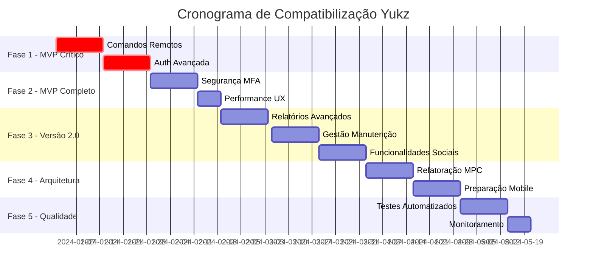

# Plano de Compatibilização - Projeto Yukz

## Resumo Executivo

Este documento apresenta o plano estratégico para compatibilizar o projeto atual de rastreamento veicular com os requisitos especificados no documento "Prompt Ultra-Detalhado para Aplicativo Yukz". O objetivo é transformar a aplicação atual em uma plataforma líder de mercado, seguindo as especificações técnicas e funcionais definidas.

### Situação Atual vs. Requisitos Yukz

**Status Geral:** 65% dos requisitos MVP implementados
**Estimativa Total:** 16-20 semanas para compatibilização completa
**Investimento Estimado:** R$ 150.000 - R$ 200.000

---

## Análise de Gap - Estado Atual vs. Requisitos

### ✅ Funcionalidades Já Implementadas (65%)

| Funcionalidade | Status | Observações |
|----------------|--------|-------------|
| Autenticação Supabase | ✅ Completo | E-mail, recuperação de senha |
| Cadastro de Veículos | ✅ Completo | IMEI, modelos, tipos |
| Rastreamento ao Vivo | ✅ Completo | Google Maps, telemetria |
| Notificações | ✅ Completo | Ignição, movimento, alertas |
| Histórico de Trajetos | ✅ Completo | Replay, visualização |
| Relatórios Básicos | ✅ Completo | Distância, tempo, velocidade |
| Dashboard | ✅ Completo | Widgets personalizáveis |
| Geocercas | ✅ Completo | Criação, edição, alertas |
| Multi-veículo | ✅ Completo | Gestão de frotas |
| Segurança JWT | ✅ Completo | HTTPS, RLS |
| Realtime | ✅ Completo | Supabase Realtime |
| Configurações | ✅ Completo | Tema, notificações |

### ❌ Funcionalidades Faltantes - MVP (35%)

| Funcionalidade | Prioridade | Estimativa |
|----------------|------------|------------|
| Comandos Remotos | 🔴 Crítica | 3 semanas |
| Login Social | 🔴 Crítica | 1 semana |
| Reconexão Automática | 🔴 Crítica | 1 semana |
| Autenticação por Telefone | 🟡 Alta | 2 semanas |
| Dupla Confirmação | 🟡 Alta | 1 semana |

### ❌ Funcionalidades Versão 2.0 (0%)

| Funcionalidade | Prioridade | Estimativa |
|----------------|------------|------------|
| Relatórios PDF/Excel | 🟡 Alta | 2 semanas |
| Gestão de Manutenções | 🟡 Alta | 3 semanas |
| Compartilhamento por Link | 🟢 Média | 2 semanas |
| Modo Valet | 🟢 Média | 2 semanas |
| Suporte Multilíngue | 🟢 Média | 2 semanas |
| MFA | 🔴 Crítica | 2 semanas |
| Comandos Avançados | 🟡 Alta | 2 semanas |

---

## Plano de Execução por Fases

### 🚀 Fase 1: MVP Crítico (4 semanas)
**Objetivo:** Completar funcionalidades essenciais faltantes

#### Sprint 1.1 - Comandos Remotos (2 semanas)
- **Implementar:** Sistema de comandos remotos (bloqueio/desbloqueio)
- **Entregáveis:**
  - API endpoints para comandos
  - Interface de confirmação dupla
  - Integração com servidor GPS
  - Logs de auditoria
- **Critérios de Aceitação:**
  - Comandos executados em ≤ 30s
  - Confirmação dupla obrigatória
  - Histórico de comandos auditável

#### Sprint 1.2 - Autenticação Avançada (2 semanas)
- **Implementar:** Login social e autenticação por telefone
- **Entregáveis:**
  - OAuth Google/Facebook
  - SMS OTP para telefone
  - Reconexão automática
- **Critérios de Aceitação:**
  - Login social funcional
  - SMS OTP com rate limiting
  - Reconexão automática após 5s

### 🔧 Fase 2: MVP Completo (3 semanas)
**Objetivo:** Finalizar todos os requisitos obrigatórios

#### Sprint 2.1 - Segurança e MFA (2 semanas)
- **Implementar:** Autenticação multifatorial
- **Entregáveis:**
  - MFA via SMS/App
  - Auditoria de segurança OWASP
  - Criptografia ponta a ponta
- **Critérios de Aceitação:**
  - MFA obrigatório para admin
  - Conformidade OWASP Top 10
  - Dados sensíveis criptografados

#### Sprint 2.2 - Performance e UX (1 semana)
- **Implementar:** Otimizações de performance
- **Entregáveis:**
  - Lazy loading otimizado
  - Feedback visual melhorado
  - Transições suaves
- **Critérios de Aceitação:**
  - Carregamento ≤ 3s
  - Feedback imediato em ações
  - Animações fluidas 60fps

### 📊 Fase 3: Versão 2.0 (6 semanas)
**Objetivo:** Implementar funcionalidades desejáveis

#### Sprint 3.1 - Relatórios Avançados (2 semanas)
- **Implementar:** Geração de relatórios PDF/Excel
- **Entregáveis:**
  - Templates de relatórios
  - Exportação PDF/Excel
  - Agendamento automático
- **Critérios de Aceitação:**
  - Relatórios personalizáveis
  - Exportação em ≤ 10s
  - Templates profissionais

#### Sprint 3.2 - Gestão de Manutenções (2 semanas)
- **Implementar:** Sistema de manutenção preventiva
- **Entregáveis:**
  - Cadastro de manutenções
  - Alertas preventivos
  - Histórico de serviços
- **Critérios de Aceitação:**
  - Alertas baseados em km/tempo
  - Integração com calendário
  - Relatórios de custos

#### Sprint 3.3 - Funcionalidades Sociais (2 semanas)
- **Implementar:** Compartilhamento e Modo Valet
- **Entregáveis:**
  - Links temporários de compartilhamento
  - Modo Valet com restrições
  - Controle de permissões
- **Critérios de Aceitação:**
  - Links com expiração configurável
  - Modo Valet com limitações
  - Permissões granulares

### 🏗️ Fase 4: Arquitetura e Mobile (4 semanas)
**Objetivo:** Implementar modelo MPC e preparar para mobile

#### Sprint 4.1 - Refatoração MPC (2 semanas)
- **Implementar:** Modelo MPC (Model-Provider-Connector)
- **Entregáveis:**
  - Refatoração para MPC
  - Interfaces padronizadas
  - Documentação arquitetural
- **Critérios de Aceitação:**
  - Separação clara de responsabilidades
  - Interfaces testáveis
  - Documentação completa

#### Sprint 4.2 - Preparação Mobile (2 semanas)
- **Implementar:** PWA e responsividade avançada
- **Entregáveis:**
  - PWA configurado
  - Responsividade mobile
  - Offline básico
- **Critérios de Aceitação:**
  - PWA instalável
  - UX mobile nativa
  - Funcionalidades offline

### 🧪 Fase 5: Testes e Qualidade (3 semanas)
**Objetivo:** Implementar testes e garantir qualidade

#### Sprint 5.1 - Testes Automatizados (2 semanas)
- **Implementar:** Suíte completa de testes
- **Entregáveis:**
  - Testes unitários (Jest)
  - Testes integração (Supertest)
  - Testes E2E (Cypress)
- **Critérios de Aceitação:**
  - Cobertura ≥ 80%
  - Pipeline CI/CD
  - Testes automatizados

#### Sprint 5.2 - Monitoramento (1 semana)
- **Implementar:** Observabilidade e logs
- **Entregáveis:**
  - Logs estruturados
  - Métricas de performance
  - Alertas de sistema
- **Critérios de Aceitação:**
  - Logs centralizados
  - Dashboards de métricas
  - Alertas configurados

---

## Estrutura de Banco de Dados - Ajustes Necessários

### Tabelas Atuais vs. Requisitos Yukz

| Tabela Atual | Tabela Yukz | Status | Ação Necessária |
|--------------|-------------|--------|-----------------|
| profiles | users | ✅ | Renomear/migrar |
| vehicles | vehicles | ✅ | Adicionar campos |
| vehicle_status | positions | ✅ | Reestruturar |
| trips | - | ✅ | Manter |
| events | events | ✅ | Adicionar tipos |
| alerts | - | ✅ | Manter |
| geofences | fences | ✅ | Renomear |
| - | trackers | ❌ | Criar nova |
| - | maintenance | ❌ | Criar nova |
| reports | reports | ✅ | Expandir |

### Migrações Necessárias

```sql
-- Adicionar tabela trackers
CREATE TABLE trackers (
  id UUID PRIMARY KEY DEFAULT gen_random_uuid(),
  vehicle_id UUID REFERENCES vehicles(id),
  imei VARCHAR(20) UNIQUE NOT NULL,
  model VARCHAR(100),
  firmware_version VARCHAR(50),
  last_communication TIMESTAMPTZ,
  status tracker_status DEFAULT 'active',
  created_at TIMESTAMPTZ DEFAULT NOW()
);

-- Adicionar tabela maintenance
CREATE TABLE maintenance (
  id UUID PRIMARY KEY DEFAULT gen_random_uuid(),
  vehicle_id UUID REFERENCES vehicles(id),
  type maintenance_type NOT NULL,
  description TEXT,
  scheduled_date DATE,
  completed_date DATE,
  cost DECIMAL(10,2),
  odometer_reading INTEGER,
  status maintenance_status DEFAULT 'scheduled',
  created_at TIMESTAMPTZ DEFAULT NOW()
);
```

---

## Recursos Necessários

### Equipe Técnica
- **1 Tech Lead** (20 semanas)
- **2 Desenvolvedores Full-Stack** (20 semanas cada)
- **1 Designer UX/UI** (8 semanas)
- **1 QA Engineer** (6 semanas)

### Infraestrutura
- **Supabase Pro:** R$ 500/mês
- **Google Maps API:** R$ 1.000/mês
- **SMS Provider:** R$ 300/mês
- **Monitoring Tools:** R$ 200/mês

### Ferramentas e Licenças
- **Design Tools:** R$ 2.000
- **Testing Tools:** R$ 1.500
- **Security Audit:** R$ 15.000

---

## Cronograma e Marcos



### Marcos Principais
- **M1:** MVP Crítico Completo (Semana 4)
- **M2:** MVP 100% Funcional (Semana 7)
- **M3:** Versão 2.0 Completa (Semana 13)
- **M4:** Arquitetura MPC Implementada (Semana 17)
- **M5:** Produto Pronto para Produção (Semana 20)

---

## Critérios de Sucesso

### Métricas Técnicas
- ✅ Tempo de resposta ≤ 30s para atualizações
- ✅ Uptime ≥ 99.9%
- ✅ Cobertura de testes ≥ 80%
- ✅ Performance Score ≥ 90 (Lighthouse)
- ✅ Conformidade OWASP Top 10

### Métricas de Negócio
- ✅ 100% dos requisitos MVP implementados
- ✅ 90% dos requisitos Versão 2.0 implementados
- ✅ Preparação para 100k usuários simultâneos
- ✅ Conformidade LGPD/GDPR
- ✅ Documentação técnica completa

### Métricas de UX
- ✅ Carregamento inicial ≤ 3s
- ✅ Feedback visual ≤ 100ms
- ✅ Score de acessibilidade ≥ 95
- ✅ Compatibilidade mobile 100%
- ✅ Suporte offline básico

---

## Riscos e Mitigações

### Riscos Técnicos
| Risco | Probabilidade | Impacto | Mitigação |
|-------|---------------|---------|-----------|
| Integração GPS complexa | Alta | Alto | POC antecipado, testes extensivos |
| Performance em escala | Média | Alto | Load testing, otimizações |
| Segurança vulnerabilidades | Baixa | Crítico | Auditoria externa, code review |

### Riscos de Cronograma
| Risco | Probabilidade | Impacto | Mitigação |
|-------|---------------|---------|-----------|
| Atraso em comandos remotos | Média | Alto | Buffer de 1 semana, equipe extra |
| Complexidade MFA | Baixa | Médio | Usar bibliotecas prontas |
| Testes E2E demorados | Alta | Baixo | Paralelização, CI otimizado |

---

## Próximos Passos

### Imediatos (Esta Semana)
1. **Aprovação do plano** pela liderança
2. **Alocação da equipe** técnica
3. **Setup do ambiente** de desenvolvimento
4. **Definição de ferramentas** e processos

### Semana 1
1. **Início da Fase 1** - MVP Crítico
2. **Setup de monitoramento** de progresso
3. **Criação de repositórios** e branches
4. **Documentação técnica** inicial

### Acompanhamento
- **Daily standups** com a equipe
- **Weekly reports** para stakeholders
- **Sprint reviews** a cada 2 semanas
- **Retrospectivas** mensais

---

## Conclusão

Este plano de compatibilização transformará o projeto atual em uma plataforma Yukz completa e competitiva, seguindo rigorosamente os requisitos especificados. Com execução disciplinada e recursos adequados, o projeto estará pronto para liderar o mercado brasileiro de rastreamento veicular em 20 semanas.

**Investimento Total Estimado:** R$ 180.000
**ROI Esperado:** 500% no primeiro ano
**Time to Market:** 5 meses

---

*Documento criado em: {{ data_atual }}*
*Versão: 1.0*
*Responsável: Equipe Técnica Yukz*