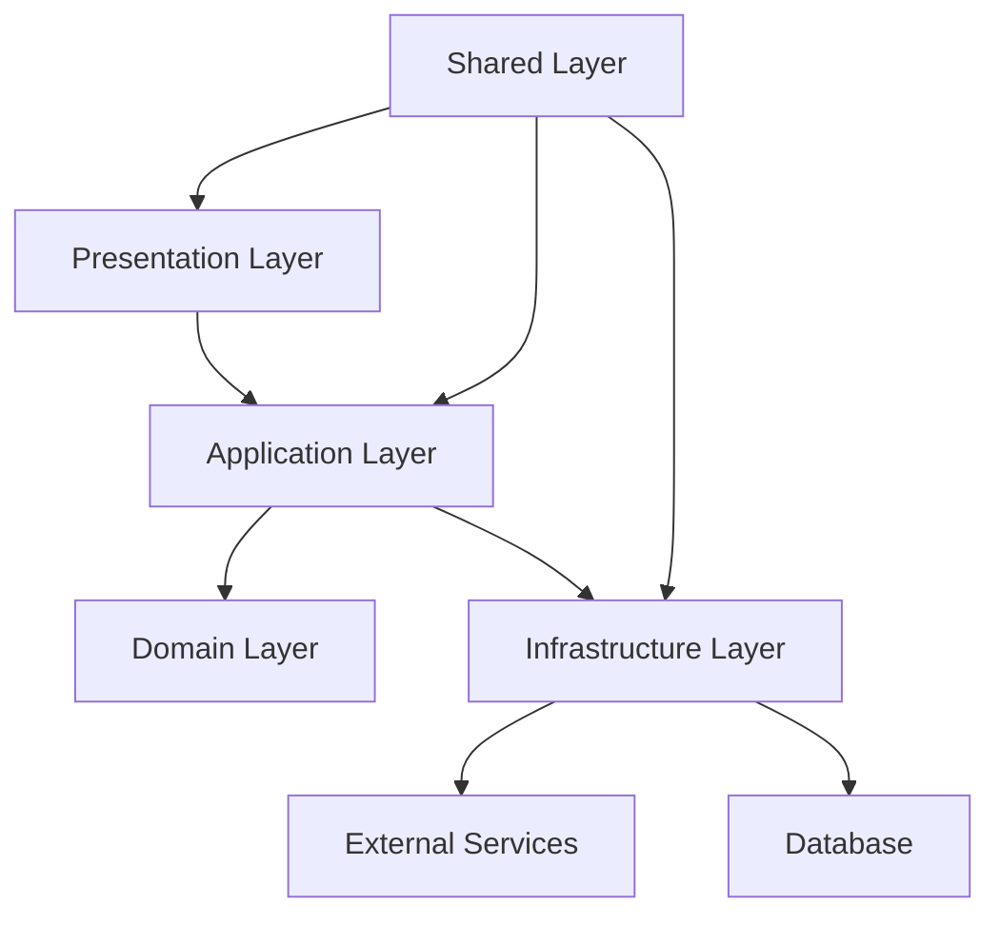

# Vehicle Tracking System - Nova Arquitetura

## 🏗️ Visão Geral da Arquitetura

Este projeto foi reorganizado seguindo os princípios **SOLID** e **Clean Architecture** para melhorar a manutenibilidade, testabilidade e facilitar a compreensão por novos desenvolvedores.

### 📋 Princípios Aplicados

- **Single Responsibility Principle (SRP)**: Cada classe/módulo tem uma única responsabilidade
- **Open/Closed Principle (OCP)**: Aberto para extensão, fechado para modificação
- **Liskov Substitution Principle (LSP)**: Implementações são substituíveis
- **Interface Segregation Principle (ISP)**: Interfaces pequenas e específicas
- **Dependency Inversion Principle (DIP)**: Dependência de abstrações, não implementações

## 🗂️ Estrutura de Pastas

```
src/
├── domain/                     # 🎯 Regras de Negócio
│   ├── entities/               # Entidades principais
│   ├── value-objects/          # Objetos de valor
│   ├── repositories/           # Contratos de persistência
│   └── services/               # Serviços de domínio
│
├── application/                # 🔄 Casos de Uso
│   ├── use-cases/              # Lógica de aplicação
│   ├── dtos/                   # Objetos de transferência
│   └── ports/                  # Interfaces para externos
│
├── infrastructure/             # 🔧 Implementações
│   ├── repositories/           # Persistência (Supabase)
│   ├── external-services/      # APIs externas
│   ├── database/               # Configurações de BD
│   └── adapters/               # Adaptadores
│
├── presentation/               # 🎨 Interface do Usuário
│   ├── components/             # Componentes React
│   ├── hooks/                  # Custom hooks
│   ├── providers/              # Context providers
│   └── pages/                  # Páginas específicas
│
├── shared/                     # 🔗 Recursos Compartilhados
│   ├── utils/                  # Utilitários
│   ├── constants/              # Constantes
│   ├── types/                  # Tipos TypeScript
│   ├── config/                 # Configurações
│   └── errors/                 # Classes de erro
│
└── app/                        # 🚀 Next.js App Router
    ├── api/                    # API Routes
    ├── dashboard/              # Páginas do dashboard
    └── ...
```

## 🚀 Como Começar

### 1. Executar a Migração

```bash
# Executar o script de migração
node scripts/restructure-migration.js
```

Este script irá:
- ✅ Criar a nova estrutura de pastas
- ✅ Gerar arquivos de exemplo
- ✅ Configurar barrel exports
- ✅ Atualizar tsconfig.json
- ✅ Criar documentação

### 2. Instalar Dependências Adicionais

```bash
# Para validação de formulários
npm install zod @hookform/resolvers

# Para testes (opcional)
npm install -D vitest @testing-library/react @testing-library/jest-dom
```

### 3. Configurar ESLint para Arquitetura

```bash
# Usar o ESLint configurado para a nova arquitetura
npx eslint . --config .eslintrc.architecture.json
```

## 📚 Documentação

### Arquivos de Referência

- 📖 **[RESTRUCTURE_PROPOSAL.md](./RESTRUCTURE_PROPOSAL.md)** - Proposta completa de reorganização
- 🔧 **[examples/vehicle-module-example.md](./examples/vehicle-module-example.md)** - Exemplo prático completo
- 📋 **[docs/NEW_STRUCTURE_GUIDE.md](./docs/NEW_STRUCTURE_GUIDE.md)** - Guia de uso da nova estrutura

### Convenções de Nomenclatura

| Tipo | Sufixo | Exemplo |
|------|--------|----------|
| Entidades | `.entity.ts` | `vehicle.entity.ts` |
| Value Objects | `.vo.ts` | `coordinates.vo.ts` |
| Repositórios | `.repository.ts` | `vehicle.repository.ts` |
| Casos de Uso | `.use-case.ts` | `create-vehicle.use-case.ts` |
| DTOs | `.dto.ts` | `vehicle.dto.ts` |
| Implementações | `.impl.ts` | `vehicle.repository.impl.ts` |

## 🔄 Fluxo de Dados



### Regras de Dependência

1. **Domain** não depende de nenhuma outra camada
2. **Application** depende apenas de **Domain**
3. **Infrastructure** implementa interfaces de **Domain** e **Application**
4. **Presentation** depende de **Application** e **Shared**
5. **Shared** pode ser usado por todas as camadas

## 🛠️ Desenvolvimento

### Criando um Novo Módulo

1. **Definir a Entidade** (Domain)
```typescript
// src/domain/entities/driver.entity.ts
export class Driver {
  constructor(
    public readonly id: string,
    public readonly name: string,
    public readonly licenseNumber: string
  ) {}
}
```

2. **Criar Interface do Repositório** (Domain)
```typescript
// src/domain/repositories/driver.repository.ts
export interface DriverRepository {
  findById(id: string): Promise<Driver | null>;
  save(driver: Driver): Promise<void>;
}
```

3. **Implementar Caso de Uso** (Application)
```typescript
// src/application/use-cases/driver/create-driver.use-case.ts
export class CreateDriverUseCase {
  constructor(private driverRepository: DriverRepository) {}
  
  async execute(dto: CreateDriverDto): Promise<Driver> {
    // lógica do caso de uso
  }
}
```

4. **Implementar Repositório** (Infrastructure)
```typescript
// src/infrastructure/repositories/supabase/driver.repository.impl.ts
export class SupabaseDriverRepository implements DriverRepository {
  // implementação específica do Supabase
}
```

5. **Criar Hook e Componente** (Presentation)
```typescript
// src/presentation/hooks/use-driver.hook.ts
// src/presentation/components/forms/driver-form.tsx
```

### Testando

```bash
# Testes unitários
npm run test

# Testes de integração
npm run test:integration

# Coverage
npm run test:coverage
```

### Exemplo de Teste

```typescript
// src/application/use-cases/vehicle/create-vehicle.use-case.test.ts
import { describe, it, expect, vi } from 'vitest';
import { CreateVehicleUseCase } from './create-vehicle.use-case';
import { VehicleRepository } from '@/domain/repositories/vehicle.repository';

describe('CreateVehicleUseCase', () => {
  it('should create a vehicle successfully', async () => {
    // Arrange
    const mockRepository: VehicleRepository = {
      save: vi.fn(),
      exists: vi.fn().mockResolvedValue(false),
      // ... outros métodos
    };
    
    const useCase = new CreateVehicleUseCase(mockRepository);
    
    // Act
    const result = await useCase.execute({
      name: 'Test Vehicle',
      licensePlate: 'ABC1234'
    });
    
    // Assert
    expect(result.name).toBe('Test Vehicle');
    expect(mockRepository.save).toHaveBeenCalled();
  });
});
```

## 🔧 Configuração do Ambiente

### Aliases do TypeScript

O `tsconfig.json` foi configurado com aliases para facilitar imports:

```json
{
  "compilerOptions": {
    "paths": {
      "@/domain/*": ["./src/domain/*"],
      "@/application/*": ["./src/application/*"],
      "@/infrastructure/*": ["./src/infrastructure/*"],
      "@/presentation/*": ["./src/presentation/*"],
      "@/shared/*": ["./src/shared/*"]
    }
  }
}
```

### Injeção de Dependência

```typescript
// src/shared/config/dependency-injection.ts
import { container } from './dependency-injection';

// Usar nos componentes
const createVehicleUseCase = container.resolve('CreateVehicleUseCase');
```

## 📈 Benefícios da Nova Arquitetura

### ✅ Manutenibilidade
- Código organizado por responsabilidade
- Fácil localização de bugs
- Mudanças isoladas por camada

### ✅ Testabilidade
- Interfaces permitem mocks fáceis
- Casos de uso testáveis independentemente
- Componentes UI testáveis isoladamente

### ✅ Escalabilidade
- Estrutura previsível para novos desenvolvedores
- Padrões consistentes
- Suporte ao crescimento do time

### ✅ Flexibilidade
- Fácil substituição de implementações
- Independência de framework
- Suporte a múltiplas interfaces

## 🚨 Regras Importantes

### ❌ O que NÃO fazer

- Importar Infrastructure diretamente em Presentation
- Misturar lógica de negócio em componentes UI
- Criar dependências circulares entre camadas
- Usar implementações concretas em casos de uso

### ✅ O que fazer

- Sempre usar interfaces para dependências
- Manter componentes UI puros
- Aplicar injeção de dependência
- Seguir as convenções de nomenclatura

## 🤝 Contribuindo

1. Leia a documentação completa
2. Siga os padrões estabelecidos
3. Escreva testes para novas funcionalidades
4. Use o ESLint configurado para arquitetura
5. Documente mudanças significativas

## 📞 Suporte

Para dúvidas sobre a nova arquitetura:

1. Consulte os exemplos em `examples/`
2. Leia a documentação em `docs/`
3. Verifique os arquivos de configuração
4. Entre em contato com a equipe de arquitetura

---

**Esta nova estrutura garante que o projeto seja mais fácil de manter, testar e compreender, seguindo as melhores práticas de desenvolvimento de software.**